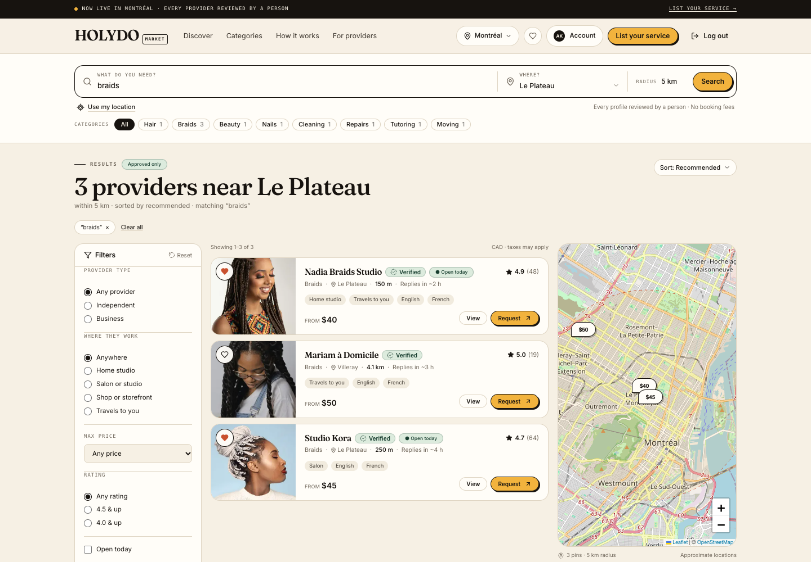
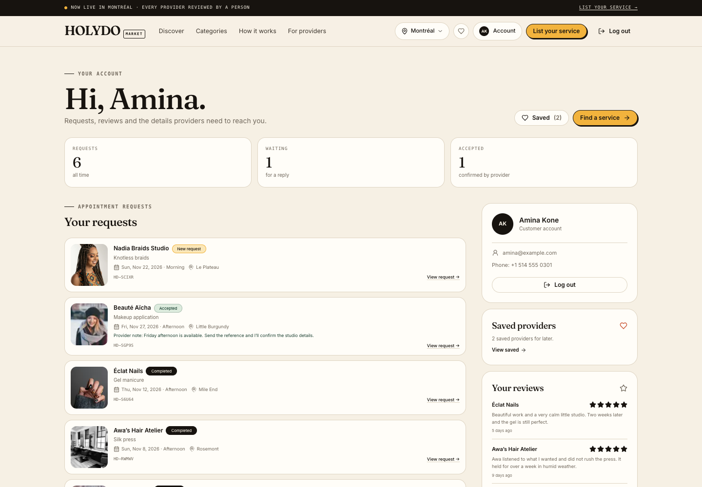
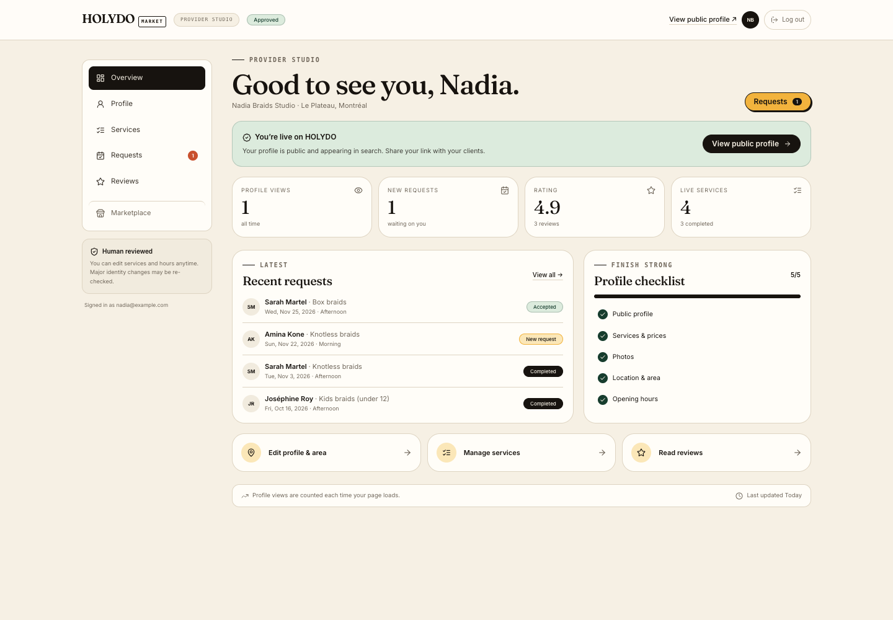
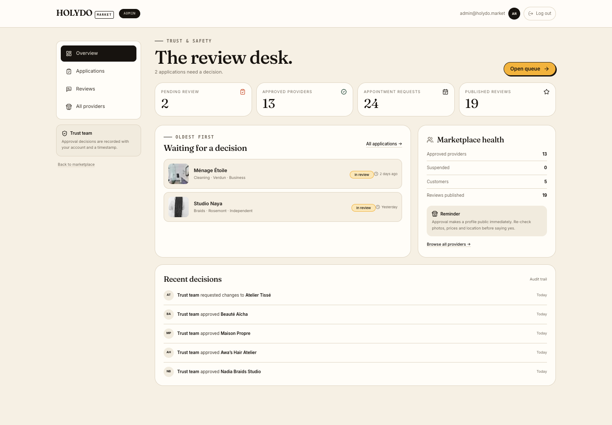
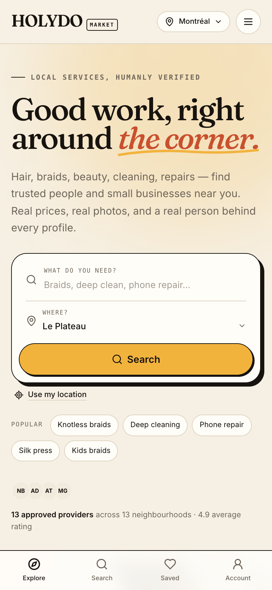
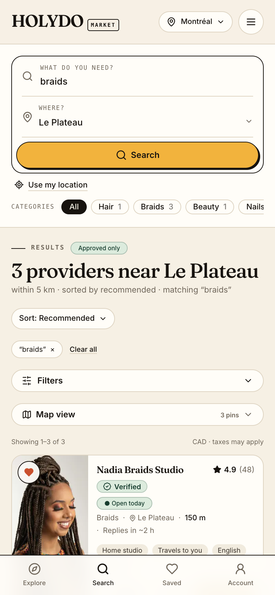
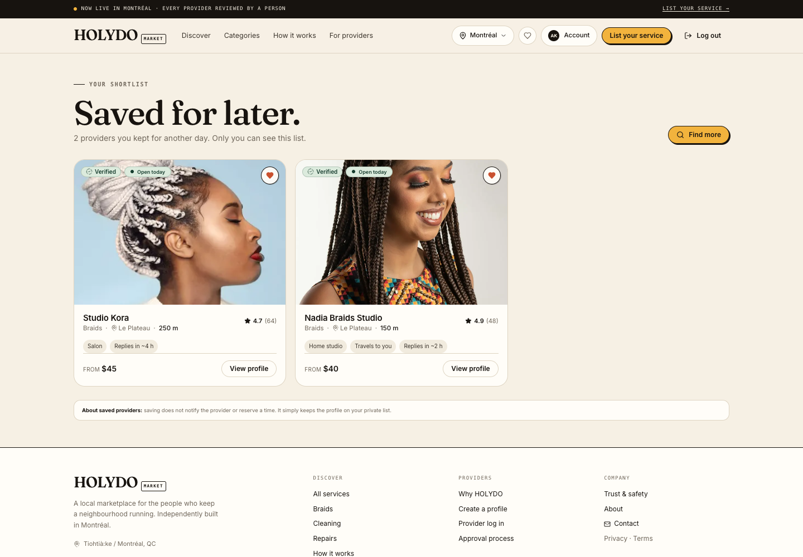
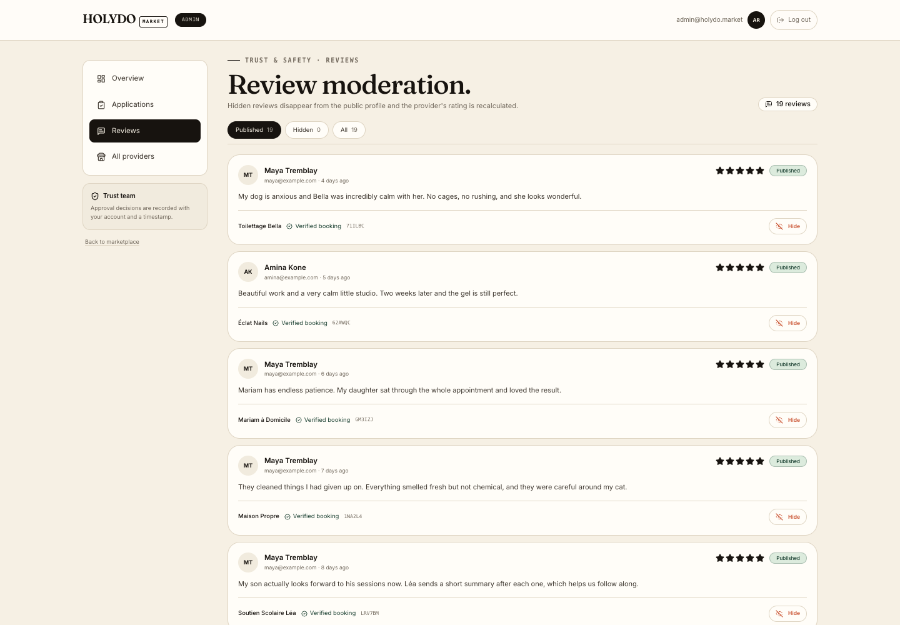

# HOLYDO MARKET

**Local services, humanly verified.** A mobile-first marketplace connecting Montréal
customers with independent providers and small businesses — hair, braids, beauty,
cleaning, repairs and more.

> **Status: v1 is built and runnable, with a v1.1 hardening pass.** The repository began
> empty; this is an original implementation based on the [v1 plan](docs/V1-PLAN.md) and the
> four approved [wireframes](wireframes/index.html). Core customer, provider and admin
> journeys have been tested end-to-end. v1.1 adds saved providers, admin review moderation
> and basic public-form rate limiting.


## Quick start

Requirements: **Node.js 20+** (tested on Node 24) and npm.

```bash
cp .env.example .env
npm install
npx prisma db push
npm run db:seed
npm run dev
```

Open **http://localhost:3000**.

`npm run db:reset` rebuilds and reseeds the SQLite database. The database lives at
`prisma/dev.db`.

### Demo accounts

| Role | Email | Password | What to try |
| --- | --- | --- | --- |
| Customer | `amina@example.com` | `Customer123!` | Requests, reviews, saved providers |
| Provider (approved) | `nadia@example.com` | `Provider123!` | Dashboard, services, requests |
| Provider (pending) | `naya@example.com` | `Provider123!` | “In review” state |
| Provider (draft) | `rose@example.com` | `Provider123!` | The 7-step onboarding |
| Admin | `admin@holydo.market` | `Admin123!` | Approval queue, suspend/reinstate |

These credentials are seeded in [`prisma/seed.ts`](prisma/seed.ts). **Change or remove them
before any public deployment.**

## A look around

| Customer home | Search results |
| --- | --- |
|  |  |
| **Provider profile** | **Customer account** |
|  |  |
| **Provider dashboard** | **Admin review desk** |
|  |  |
| **Mobile home** | **Mobile search** |
|  |  |
| **Saved providers** | **Admin review moderation** |
|  |  |

## What is included

### Customers

- Homepage with service + neighbourhood search, categories, nearby providers, trust story and
  neighbourhood browsing.
- Search results with URL-backed filters (type, place, price, rating, open now, distance),
  sorting, pagination, a desktop map and a mobile map toggle.
- Provider profiles with photo gallery, about, services and prices, opening hours, approximate
  service area, verified reviews and a sticky request action.
- Appointment request sheet with service, date, preferred window, contact details and a note.
  No account required to send a request.
- Confirmation page with a shareable reference; provider replies appear there and in the
  customer account.
- Customer account with requests, provider notes, reviews, and logout.
- Saved providers: a private shortlist at `/saved`, a heart control on cards and profiles,
  and a saved-provider shortcut in the header and mobile tab bar.
- Sign-up / login, installable web app manifest, sitemap, robots rules and JSON-LD.

### Providers

- Free provider account creation and a **7-step application**: account, business, services,
  photos, location/area, opening hours, review & submit.
- Draft providers can save and resume; every step persists to the database.
- Photo upload (JPG/PNG/WebP, max 6 MB, up to 8 photos) with local storage.
- Provider dashboard with profile completeness, views, requests, rating and quick actions.
- Edit public profile, service settings, private address, travel radius, service areas, photos
  and opening hours.
- Service CRUD with live/hidden state and prices.
- Request inbox with accept, decline, complete and cancel actions plus a reply note.
- Review list, verified-review indicators and reputation summary.
- Status-aware experience for draft, in review, approved, changes requested and suspended.

### Administrators

- Protected `/admin` area with an approval queue.
- Full application review: profile, applicant contact, private address, photos, services,
  prices, hours, service area and a completeness checklist.
- Approve & publish, request changes with a required note, suspend and reinstate.
- Review moderation: hide or restore any review. Hidden reviews disappear from the public
  profile and the provider's weighted rating is recalculated in both directions.
- Every decision is written to an `AdminAction` audit trail and attributed to the admin.

### Only approved profiles are public

```
DRAFT ──submit──▶ PENDING ──approve──▶ APPROVED ──suspend──▶ SUSPENDED
  ▲                  │                    ▲                    │
  │                  └──reject──▶ REJECTED ──resubmit──────────┘
  └──────────────────── edit ◀─────────────────────────────────┘
```

Search, the sitemap, profile routes and the public map all filter on `status = APPROVED`.
Draft, pending, rejected and suspended providers return 404 publicly.

## Stack

| Layer | Choice |
| --- | --- |
| Framework | Next.js 15 App Router + React 19 + TypeScript |
| Styling | Tailwind CSS v4, self-hosted Fraunces + Inter variable fonts |
| Database | Prisma 6 + SQLite (PostgreSQL-ready schema) |
| Auth | Email/password with Node `scrypt` + database-backed HttpOnly sessions |
| Maps | Leaflet + OpenStreetMap, dynamically imported |
| Validation | Zod on every server action |
| Icons | Lucide |
| Tests | Vitest (45 unit tests) |

### Why scrypt instead of Argon2id?

The plan proposed Argon2id. The implementation uses Node's built-in **scrypt** instead, to
avoid a platform-specific native dependency in the demo. It is memory-hard, salted per
password, and stored in an upgradeable `scrypt$salt$hash` format. If the project moves to
Argon2id, hashes can be re-derived on next login without changing the user model.

## Project structure

```
app/
  (public)/              public layout, home, search, provider profile, account, saved,
                         requests, how-it-works, for-providers
  (auth)/                login, signup, minimal auth layout
  provider/join/         step 1 of the provider application
  provider/onboarding/   7-step application (server actions, uploaded photos)
  provider/dashboard/    overview, profile, services, requests, reviews
  admin/                 overview, applications queue, application detail, reviews, all providers
  actions/               auth, provider, request/review and admin server actions
  api/                   (none — server actions are used throughout)
components/              shared UI: header/footer, cards, filters, map, booking sheet, forms
lib/                     Prisma client, auth, location, formatting, search, validation helpers
prisma/                  schema, seed data, SQLite database
public/images/           demo photography and image credits
wireframes/              approved wireframes and screenshots
docs/                    repository review, v1 plan, wireframe notes, final screenshots
```

### Key files

- [`prisma/schema.prisma`](prisma/schema.prisma) — users, providers, services, photos, hours,
  areas, requests, reviews, admin audit log.
- [`prisma/seed.ts`](prisma/seed.ts) — 12 categories, 17 providers (13 approved, 2 pending,
  1 draft, 1 rejected), 19 reviews, 24 requests and 2 saved providers.
- [`lib/search.ts`](lib/search.ts) — approved-only search, distance, filters, sorting,
  map points and provider profile queries.
- [`lib/auth.ts`](lib/auth.ts) — sessions, role guards, provider/admin access.
- [`lib/saved.ts`](lib/saved.ts) — the customer's private saved-provider set.
- [`lib/reviews.ts`](lib/reviews.ts) — weighted rating recalculation for moderation.
- [`lib/rate-limit.ts`](lib/rate-limit.ts) — in-process rate limiting for public forms.
- [`app/actions/provider.ts`](app/actions/provider.ts) — the full provider lifecycle.
- [`app/actions/admin.ts`](app/actions/admin.ts) — approval and moderation with audit logging.

## Customer journey

1. Land on `/`, choose a category or search (“braids”, “deep clean”).
2. Pick a neighbourhood (or use location); see approved providers by distance, price and trust.
3. Open a profile: photos, services, prices, hours, travel area, reviews.
4. Send a request with a preferred date and window — no account wall.
5. Get a reference; the provider accepts/declines from the dashboard.
6. See the provider’s reply on the request page/account.
7. After the appointment, leave a review; a verified badge appears when it is linked to a
   completed HOLYDO request.

## Provider journey

1. `/provider/join` → create account + choose a category.
2. Complete the 7 steps. Each step saves; “Save & exit” returns to the dashboard.
3. Submit for approval (required fields validated).
4. Status becomes **In review**; the profile stays private.
5. Admin approves or requests changes with a note.
6. Approved → profile appears in search, sitemap and its public URL.
7. Dashboard: update profile/services/hours, accept requests, respond and read reviews.

## Design system

- **Ink** `#17130F`, **Paper** `#F6F0E4`, **Surface** `#FFFDF8`
- **Marigold** `#F2B33D`, **Clay** `#C9502E`, **Pine** `#173D2E`
- Fraunces for display type; Inter for UI.
- Ink borders, sticker-offset shadows, generous mobile whitespace, bottom navigation, sticky
  request bars, bottom-sheet filters and reduced-motion support.
- The three Awwwards references informed structure only — community framing (Parkbench),
  marketplace logic (The Gigs) and directory presentation (Sparker). No layout, copy, logo,
  asset or code was copied.

## Commands

| Command | Purpose |
| --- | --- |
| `npm run dev` | Start the development server |
| `npm run build` | Production build (verified) |
| `npm start` | Start the production server |
| `npm run lint` | ESLint |
| `npm run typecheck` | TypeScript, no emit |
| `npm test` | Vitest unit tests |
| `npm run db:push` | Apply the Prisma schema |
| `npm run db:seed` | Seed demo data |
| `npm run db:reset` | Force-reset and reseed |

## Verification performed

- `npm run build` succeeds; all routes compile.
- `npm run typecheck`, `npm run lint` and `npm test` (45 tests) pass.
- Browser-tested customer request flow through the booking sheet → confirmation page.
- Browser-tested a brand-new provider through all 7 onboarding steps, photo upload, submit,
  admin approval, and the resulting public profile.
- Browser-tested provider request acceptance, review submission, customer login, provider login
  and admin login.
- Browser-tested saving/unsaving providers, the private `/saved` page, and admin hide/publish
  review moderation with rating recalculation (48 → 47 → 48 reviews).
- Mobile viewport checks at 390 × 844: no horizontal overflow on home, search, profile, join,
  login, onboarding or dashboard.

## Known limitations (intentional for v1)

- **No email/SMS delivery.** Requests and status changes live in the app; the provider replies
  through the contact details shown. Email verification and notifications are the next
  infrastructure step.
- **No payments, deposits, payouts or commission.** Appointments are requests confirmed
  directly by the provider.
- **No calendar sync or real-time availability.** Opening hours are a guide.
- **No password reset or OAuth.** Email + password only.
- **Local image storage.** `public/uploads` is for the demo; production should use object
  storage with image processing and virus/MIME scanning.
- **SQLite.** The schema avoids SQLite-specific features and is ready for Postgres, but v1 runs
  on a local SQLite file.
- **Rate limiting is in-memory and per process.** It covers booking requests and reviews with
  a modest burst limit, but a multi-instance deployment needs a shared store (Redis/Upstash)
  plus CAPTCHA or another bot defence.
- **Review aggregates mix demo history and recent rows.** Seeded providers carry a lifetime
  rating count while only the most recent reviews are rows; moderation recalculates the
  weighted aggregate correctly, but the two views intentionally differ.
- **Search filters in application code** after an indexed approved-provider query. Fine for
  this dataset; production should use PostGIS/geohash and pagination in SQL.
- **Demo photography** from Unsplash — see [image credits](public/images/ATTRIBUTION.md).
- **Test data is fictional**, including provider names, prices, addresses and reviews.

## Next steps

1. Transactional email (request received, approved, rejected, status changes) and password reset.
2. Postgres + object storage + image processing.
3. Rate limiting, CAPTCHA on requests, and email verification.
4. Real availability / calendar slots and provider response templates.
5. Distributed rate limiting, CAPTCHA on public forms, and supply-demand analytics.
6. French localisation and a bilingual content model.

## Planning documents

- [Repository review](docs/REPOSITORY-REVIEW.md) — what existed before (nothing) and why.
- [V1 plan](docs/V1-PLAN.md) — scope, schema, approval rules, journeys, milestones.
- [Wireframe notes](docs/WIREFRAMES.md) — interaction decisions and states.
- [Wireframe gallery](wireframes/index.html) — the approved desktop/mobile screens.

---

Built as an original product for HOLYDO MARKET. Demo photography is credited above and is not
the work of the fictional providers.
